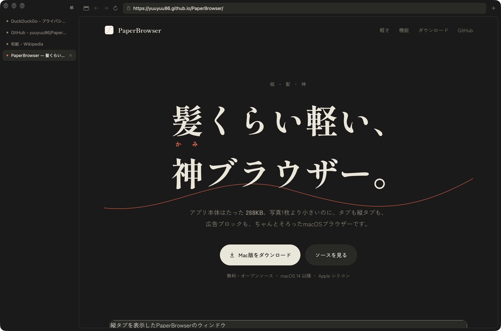

<p align="center"></p>
<h1 align="center">PaperBrowser</h1>
<p align="center"><b>髪くらい軽い、神ブラウザー。</b><br>A hair-light, god-tier browser for macOS — the whole app is <b>304 KB</b>.</p>
<p align="center"><a href="https://yuuyuu86.github.io/PaperBrowser/">Website</a> · <a href="https://github.com/yuuyuu86/PaperBrowser/releases/latest/download/PaperBrowser.zip">Download</a></p>



紙(paper)・髪(hair)・神(god) — all read *kami* in Japanese.

## Why it's light
- Uses the system WebKit instead of bundling an engine: one Swift file, zero dependencies, **304 KB app / 32 MB app process**
- Background tabs idle for 5 minutes are fully unloaded (WebKit content process exits); all hidden tabs unload on memory pressure
- Built-in ad/tracker blocking (`Resources/blocklist.txt`, third-party requests only)
- **Lite Mode** (leaf button or ⌥⌘L): turn JavaScript off per site for pages you only read — remembered per site, never saved for private windows
- No media autoplay (click to play); hidden tabs are suspended by WebKit

## Features
Vertical tabs or top tabs (⌃⌘S), windows, private windows, address bar search (DuckDuckGo), back/forward & swipe, find in page, zoom, full screen, print, downloads (to ~/Downloads, never auto-opened), file upload, popups, JS dialogs, camera/mic with prompt, ⌘-click background tabs, ⌘1–9 / ⌃Tab.

## Security
- App Sandbox + Hardened Runtime
- HTTPS-first: plain-HTTP pages are upgraded; insecure fallback only after explicit confirmation
- Lock / warning indicator (mixed content counts as not secure)
- Fraudulent-site warning on; Web Inspector off
- Only http/https/about/blob/data load in the browser; other schemes need confirmation
- No popups without a user gesture; camera/mic always prompt
- Private windows use a non-persistent data store; "Clear Browsing Data…" menu

## Install
Download `PaperBrowser.zip` from [Releases](https://github.com/yuuyuu86/PaperBrowser/releases), move the app to Applications.
The build is ad-hoc signed (not notarized), so on first launch right-click → **Open**.

## Build
```sh
./build.sh                                   # → build/PaperBrowser.app
SIGN_ID="Developer ID Application: …" ./build.sh
```
Requires macOS 14+ and Xcode command line tools. Tweak the tab sleep delay with
`defaults write dev.yuuyuu86.PaperBrowser SuspendAfter 600` (seconds).

## License
MIT
